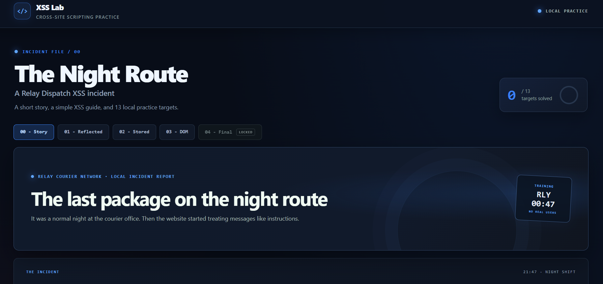
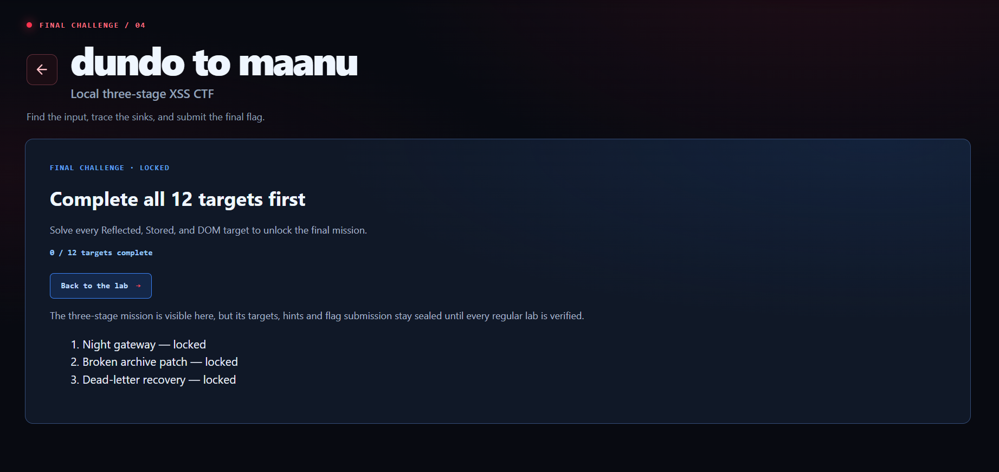
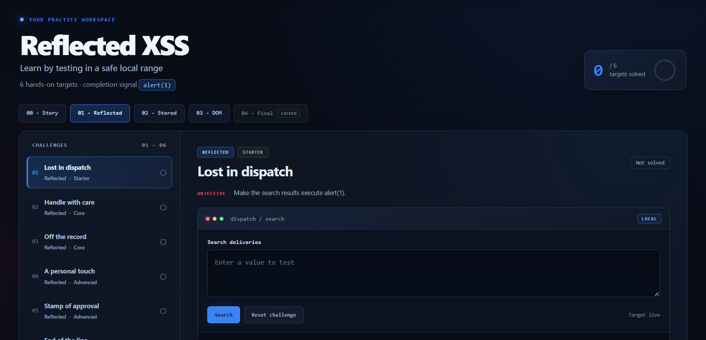

# 🛡️ XSS Practice Lab

A local PHP web application for learning Cross-Site Scripting (XSS) through hands-on practice. It includes reflected, stored, DOM-based, and final challenge labs.

## ✨ Features

- 6 reflected XSS targets
- 3 stored XSS targets
- 3 DOM XSS targets
- A three-stage final challenge
- Progress tracking during the PHP session
- Safety restrictions for localhost use

## 🛠️ Technologies Used

- PHP
- HTML5
- CSS3
- JavaScript
- Apache (XAMPP)

## 📁 Project Structure

```text
XSS-Lab/
├── assets/       # Styles and browser-side scripts
├── dom/          # DOM XSS targets
├── final/        # Final multi-stage challenge
├── reflected/    # Reflected XSS targets
├── shared/       # Shared PHP pages and verification
├── screenshots/  # README project screenshots
├── stored/       # Stored XSS targets
├── tests/        # Local security regression test
├── .gitattributes
├── .gitignore
├── LICENSE
├── README.md
├── requirements.txt
├── index.php
└── story.php
```

## 🚀 Run the Project

1. Install and open [XAMPP](https://www.apachefriends.org/).
2. Copy the `XSS-Lab` folder into `C:\xampp\htdocs`.
3. Start **Apache** in the XAMPP Control Panel. MySQL is not required.
4. Open [http://localhost/XSS-Lab/](http://localhost/XSS-Lab/) in a browser.

For challenge completion checks, install Node.js 22 or later and use Microsoft Edge or Google Chrome. The site opens without this optional verifier setup.

## 🖥️ Project Preview

### Home / Story Page



### Final Challenge



### Reflected XSS Lab



## 🎯 Learning Goals

- Understand how XSS can happen in different browser contexts
- Practice identifying unsafe input handling in a controlled lab
- Learn safer web development practices after completing a target

## ⚠️ Safety

This application is intentionally vulnerable for training. Run it only on your own computer. Do not host it publicly or test it against systems without permission.

## 👨‍💻 Author

**Blue_rpk** (Rohit Prajapat)  
GitHub: [rpk4765](https://github.com/rpk4765)

## 📄 License

This project is licensed under the MIT License. See [LICENSE](LICENSE) for details.
